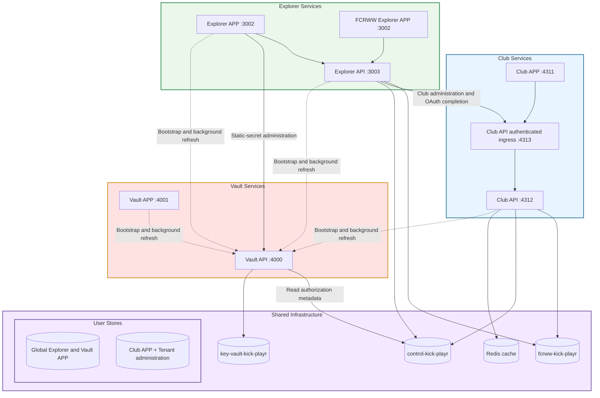

# Kick Playr architecture and local operations

**Environment:** `development`

**Tenant:** `fcrww` — FC Rot-Weiss Winikon

**Verified:** 7 November 2026

This document consolidates the component inventory, local URLs, startup commands,
active environment settings and database destinations verified during the Vault
cutover. Credentials and connection-string query options are intentionally omitted.
It describes the local setup; production addresses must come from deployment
configuration.

## 1. Components and repository names

| Component | Vault application ID | Repository | Local checkout |
| --- | --- | --- | --- |
| Vault API | Root service | `kick-playr/key-vault-api` | `/Users/Lolo/git/key-vault-api` |
| Vault APP | `vault-app` | `kick-playr/key-vault-app` | `/Users/Lolo/git/key-vault-app` |
| Tenant Explorer API | `explorer-api` | `kick-playr/kick-playr-tenant-explorer-api` | `/Users/Lolo/git/kick-playr-tenant-explorer-api` |
| Tenant Explorer APP | `explorer-app` | `kick-playr/kick-playr-tenant-explorer` | `/Users/Lolo/git/kick-playr-tenant-explorer` |
| Club API | `club-api` | `lolo8304/fcrww-api` | `/Users/Lolo/git/fcrww-api-kick-playr-ch` |
| Club APP | `club-app` | `lolo8304/fcrww-app` | `/Users/Lolo/git/fcrww-app-kick-playr-ch` |

Tenant administration and club administration are sections of **Explorer APP**.
They do not require additional processes, repositories or env files.

## 2. Architecture overview



The APPs have no direct MongoDB connections. Their server-side loaders obtain
explicitly linked static secrets from Vault. Browser code does not receive
server-side credentials or Vault grants.

## 3. URLs, ports and login realms

| Purpose | URL | Port | UI |
| --- | --- | --- |---|
| FCRWW Club APP | [http://fcrww.localhost:4311/](http://fcrww.localhost:4311/) | 4311 |x|
| FCRWW Club API  | [http://fcrww.localhost:4312/](http://fcrww.localhost:4312/) | 4312 |
| - Club Swagger | [http://127.0.0.1:4312/swagger-api](http://127.0.0.1:4312/swagger-api) | 4312 |
| - Club internal authenticated ingress | [http://127.0.0.1:4313](http://127.0.0.1:4313)| 4313 |
| FCRWW tenant / club administration | [http://fcrww.explorer.localhost:3002/](http://fcrww.explorer.localhost:3002/) | 3002 |x|
| | |  |
| Explorer global administration | [http://localhost:3002/](http://localhost:3002/) | 3002 |x|
| Explorer API  | [http://127.0.0.1:3003/](http://127.0.0.1:3003/) | 3003 |
| - Explorer API health | [http://127.0.0.1:3003/healthcheck](http://127.0.0.1:3003/healthcheck) | 3003 |
| - Explorer Swagger | [http://127.0.0.1:3003/docs](http://127.0.0.1:3003/docs) | 3003 |
| | |  |
| Vault administration UI | [http://localhost:4001/](http://localhost:4001/) | 4001 |x|
| Vault API  | [http://127.0.0.1:4000/](http://127.0.0.1:4000/) | 4000 |
| - Vault Swagger | [http://127.0.0.1:4000/docs](http://127.0.0.1:4000/docs) | 4000 |

API origins are not application homepages. Protected API operations still require
authentication when accessed directly, including operations invoked from Swagger.
Port 4313 is owned by Club API and starts with it; it is not a separate component.

| Login scope | Clerk realm |
| --- | --- |
| Global Explorer and Vault APP | `https://merry-termite-9217.clerk.accounts.dev` |
| FCRWW tenant administration and Club APP | `https://moved-seahorse-64.clerk.accounts.dev` |

Use the tenant hostname to select the FCRWW login. Vault APP currently shares the
global Explorer login; the original separate Vault login is not the active setup.

### Bexio callback

Register this exact URL in the Bexio developer console:

```text
http://fcrww.localhost:4311/bexio/oauth/callback
```

For an Explorer-initiated reconnect in the local development setup:

1. Explorer starts the authorization using the signed-in tenant admin's session.
2. Bexio redirects to the registered Club APP callback.
3. The local callback relay returns the request to the fixed FCRWW Explorer
   callback route, which obtains the current Explorer session token.
4. Explorer API authorizes the tenant admin and forwards the callback through the
   Club ingress. Club API verifies the original tenant, session, provider,
   callback and one-time state before exchanging the code.
5. Runtime credentials are stored encrypted in the tenant database.

OAuth state is a short, random reference; its validation data stays server-side.
The local Explorer relay is development-specific. Keep the five services involved
in reconnect running: Vault API, Explorer API, Explorer APP, Club API and Club APP.

## 4. How to start each component

Use **Node.js 24.x**. Run `nvm use 24` when using nvm. Run `npm ci` in each
repository on initial setup or after dependency changes.

Start each component in its own terminal, from its checkout directory:

| Order | Component | Directory | Development command | Ports opened |
| --- | --- | --- | --- | --- |
| 1 | Vault API | `/Users/Lolo/git/key-vault-api` | `npm run start:dev` | 4000 |
| 2 | Explorer API | `/Users/Lolo/git/kick-playr-tenant-explorer-api` | `npm run dev` | 3003 |
| 2 | Club API | `/Users/Lolo/git/fcrww-api-kick-playr-ch` | `npm run start:tenant-local` | 4312, 4313 |
| 3 | Vault APP | `/Users/Lolo/git/key-vault-app` | `npm run dev` | 4001 |
| 3 | Explorer APP | `/Users/Lolo/git/kick-playr-tenant-explorer` | `npm run dev` | 3002 |
| 3 | Club APP | `/Users/Lolo/git/fcrww-app-kick-playr-ch` | `npm run start:tenant-local` | 4311 |

Before starting the components, make the configured MongoDB deployment reachable
and ensure Redis is reachable when enabled by runtime configuration. Wait for
Vault's `Local vault ready` message before starting consumers. Wait for API
readiness before opening the APPs; Club API reports `"state":"ready"`.

The two Club `start:tenant-local` commands are independent. Club API also provides
`npm run start:tenant-local:combined`, but use the separate commands above when
controlling APP and API independently. Generic Club startup commands use a
different launch path and are not interchangeable with this tenant-local setup.

### Running built output

Vault API, Vault APP, Explorer API and Explorer APP also support:

```sh
npm run build
npm start
```

These commands use the same component ports shown above. Rebuild and restart that
component after source changes when running built output. Keep the tenant-local
commands for the Club pair.

Stop a component with `Ctrl+C` in its terminal. Prefer stopping APPs first,
consumer APIs second and Vault API last. Development commands watch source
changes; changed bootstrap environment settings may require a restart.

## 5. Active environment files

The following inventory reflects the local files verified on the date above.
Each file is untracked by Git, has filesystem mode `0600`, and contains no
commented-out variable assignments. Files ending in `.old` are backups and are
not the active dotenv files; they can still contain old secrets.

| Component | Active file | Variables present |
| --- | --- | --- |
| Vault API | `/Users/Lolo/git/key-vault-api/.env` | `VAULT_AUDIT_DESTINATIONS`, `VAULT_DEPLOYMENT_GRANT_DIRECTORY`, `VAULT_MASTER_KEY`, `VAULT_MONGODB_URI`, `VAULT_STORAGE_AUTHORITY` |
| Vault APP | `/Users/Lolo/git/key-vault-app/.env` | Four Vault bootstrap variables below; `VAULT_PROVISIONING_GRANT`; `NODE_ENV`; two Clerk sign-in routing variables |
| Explorer API | `/Users/Lolo/git/kick-playr-tenant-explorer-api/.env` | Four Vault bootstrap variables; `NODE_ENV`; `PORT` |
| Explorer APP | `/Users/Lolo/git/kick-playr-tenant-explorer/.env.local` | Four Vault bootstrap variables; `VAULT_PROVISIONING_GRANT`; `NODE_ENV` |
| Club API | `/Users/Lolo/git/fcrww-api-kick-playr-ch/.env` | Four Vault bootstrap variables; `NODE_ENV`; `LOG_LEVEL` |
| Club APP | `/Users/Lolo/git/fcrww-app-kick-playr-ch/.env` | Four Vault bootstrap variables; `NODE_ENV`; six feature settings below |

### Consumer bootstrap variables

| Variable | Local value | Purpose |
| --- | --- | --- |
| `VAULT_URL` | `http://127.0.0.1:4000` | Vault API destination |
| `VAULT_APPLICATION_ID` | `vault-app`, `explorer-api`, `explorer-app`, `club-api` or `club-app` | Identifies the component and its explicit resource links |
| `VAULT_ENVIRONMENT` | `development` | Selects the environment |
| `VAULT_GRANT` | Private credential; set separately for each consumer | Authorizes application bootstrap and refresh |
| `VAULT_PROVISIONING_GRANT` | Private credential; Vault APP and Explorer APP only | Authorizes the administration channel; user authorization and tenant consent are checked separately |

Having `VAULT_APPLICATION_ID` selects the new bootstrap integration; a local
`SECRETS_KEYS_STRATEGY` assignment is not required in these consumer files.

### Vault API bootstrap settings

| Variable | Current setting | Purpose |
| --- | --- | --- |
| `VAULT_STORAGE_AUTHORITY` | `v2` | Selects the normalized data model |
| `VAULT_MASTER_KEY` | Private; set | Root encryption key, supplied outside Vault |
| `VAULT_MONGODB_URI` | Private connection string; set | Connects to `key-vault-kick-playr`; sanitized destination below |
| `VAULT_AUDIT_DESTINATIONS` | Configured JSON | Audit routing |
| `VAULT_DEPLOYMENT_GRANT_DIRECTORY` | `/Users/Lolo/git/key-vault-api/.superpowers/sdd/2026-11-06-static-vault-bootstrap/deployment-grants` | Private deployment grant delivery directory |

Vault API must retain its own master key and database bootstrap connection outside
Vault so it can start independently. `VAULT_BASE_URL` is not assigned in the
current file; its default is `http://127.0.0.1:4000`.

### Operational and feature settings

| Component | Variable | Current file value | Meaning |
| --- | --- | --- | --- |
| All five consumers | `NODE_ENV` | `development` | Local environment setting; startup commands or exported variables can override it |
| Vault APP | `NEXT_PUBLIC_CLERK_SIGN_IN_URL` | `/sign-in` | Sign-in route |
| Vault APP | `NEXT_PUBLIC_CLERK_SIGN_IN_FALLBACK_REDIRECT_URL` | `/` | Default destination after sign-in |
| Explorer API | `PORT` | `3003` | API listener port |
| Club API | `LOG_LEVEL` | `debug` | Detailed logging remains enabled |
| Club APP | `FEATURE_CHATS` | `true` | Enables chats |
| Club APP | `FEATURE_CHAT_ROLES_ENABLED` | `admin,trainer,member` | Roles enabled for chat |
| Club APP | `FEATURE_CHAT_SEARCH` | `messages` | Chat search mode |
| Club APP | `FEATURE_MATRIX_BLOCK_WRITES` | `false` | Matrix writes are not blocked by this flag |
| Club APP | `IMAGE_OPTIMIZATIONS` | `false` | Optional image processing is disabled |
| Club APP | `NO_REFRESH` | `false` | Refresh is enabled |

Clerk secret keys, tenant MongoDB credentials and integration static credentials
are absent from these active consumer env files. They are explicitly linked in
Vault and loaded into server memory. Public Clerk configuration can reach the
browser as required for login; server-side credentials and Vault grants cannot.

## 6. Database names and URLs

All three current MongoDB databases use this Atlas cluster:

```text
kick-playr-ch.jdel691.mongodb.net
```

These are **sanitized destinations**, not complete usable credentials:

| Database | Sanitized URL | Stores |
| --- | --- | --- |
| `key-vault-kick-playr` | `mongodb+srv://kick-playr-ch.jdel691.mongodb.net/key-vault-kick-playr` | Vault resources, encrypted versions, links, grants, consent and instance/rotation metadata |
| `control-kick-playr` | `mongodb+srv://kick-playr-ch.jdel691.mongodb.net/control-kick-playr` | Tenant definitions, runtime authority and platform control data |
| `fcrww-kick-playr` | `mongodb+srv://kick-playr-ch.jdel691.mongodb.net/fcrww-kick-playr` | FCRWW business data, application configuration and encrypted runtime integration credentials |

The tenant database naming convention is `<tenant>-kick-playr`; FCRWW uses
`fcrww-kick-playr`.

### Connections by component

| Component | Direct database access | Configuration source |
| --- | --- | --- |
| Vault API | `key-vault-kick-playr`; authorization reads from `control-kick-playr` | Root `.env` MongoDB connection and explicit database selection |
| Vault APP | None | Vault API over HTTP |
| Explorer API | `control-kick-playr`; linked tenant database `fcrww-kick-playr` | Vault application and tenant links |
| Explorer APP | None | Explorer API and Vault API over HTTP |
| Club API | `control-kick-playr`; linked tenant database `fcrww-kick-playr` | Vault application and tenant links |
| Club APP | None | Club API through its authenticated ingress |

### Verified Vault resource mappings

| Vault resource | Owner | Consuming application / mapping | Database |
| --- | --- | --- | --- |
| `club-api-control-mongodb-uri` | Application `club-api` | Club API: `TENANT_CONTROL_MONGODB_URI` | `control-kick-playr` |
| `explorer-mongodb-uri` | Application `explorer-api` | Explorer API: `EXPLORER_MONGODB_URI` | `control-kick-playr` |
| `fcrww-mongodb-uri` | Tenant `fcrww` | Club API and Explorer API: tenant `MONGODB_URI` | `fcrww-kick-playr` |

### Redis

| Consumer | Vault resource / mapping | Sanitized destination | Purpose |
| --- | --- | --- | --- |
| Club API | `workflow-redis-url` / `REDIS_URL` | `redis://spirited-keystone-turbosmart-80955.db.redis.io:10667` | Runtime caching, including security-context acceleration where enabled |

The Redis destination above omits credentials. MongoDB remains the authoritative
data store; runtime credentials belong in the tenant database, not Vault.

## 7. Secret loading, ownership and authorization

- Applications load only their explicitly linked application and tenant resources.
  Tenant assignment alone does not grant every tenant secret.
- Static secrets, encryption keys and schema-validated integration JSON live in
  Vault. Secret metadata is indexed in plaintext; values are encrypted.
- Required static values load before application readiness. Background refresh
  checks for changed generations at intervals of at least one minute. Business
  requests use the installed memory snapshot, without per-request static-secret
  retrieval from Vault. Explicit Vault administration operations still call Vault.
- Access tokens and refresh tokens are encrypted in the tenant database. They
  are not stored as Vault static secrets. Applications sharing an integration
  share its runtime record and coordinate refresh ownership.
- Normal workload grants are read-only. Separate provisioning grants support
  administration, subject to the authenticated user's permissions.
- Club admins manage their own tenant. Global admins can inspect metadata;
  viewing or editing tenant values requires the tenant club admin's consent,
  which remains active until revoked.
- Workload-only credentials, including application database credentials and
  control keys, are delivered to workloads. Admins see their metadata; value
  access uses the operator/deployment path rather than ordinary UI reveal controls.

## 8. Operational checks

| Symptom | Check |
| --- | --- |
| Port already occupied | Run `lsof -nP -iTCP:PORT -sTCP:LISTEN`; identify the owner before stopping it |
| Bootstrap waits / readiness unavailable | Vault API, MongoDB connectivity, application grant, tenant assignments and explicit resource links |
| Club APP cannot reach API | Club API ready message and listeners on 4312 and 4313 |
| Wrong Clerk login | Use the correct global or tenant hostname from the URL table |
| Source changes missing under `npm start` | Rebuild and restart the affected component |
| OAuth reconnect fails | Start all participating components; use a fresh reconnect rather than reloading an already consumed callback |

The env inventory describes files, not arbitrary overrides in an IDE, shell or
deployment service. Recheck exported environment variables if actual behavior
differs from the documented local configuration.

For a shorter command-focused reference, see [Local startup](LOCAL-STARTUP.md).
